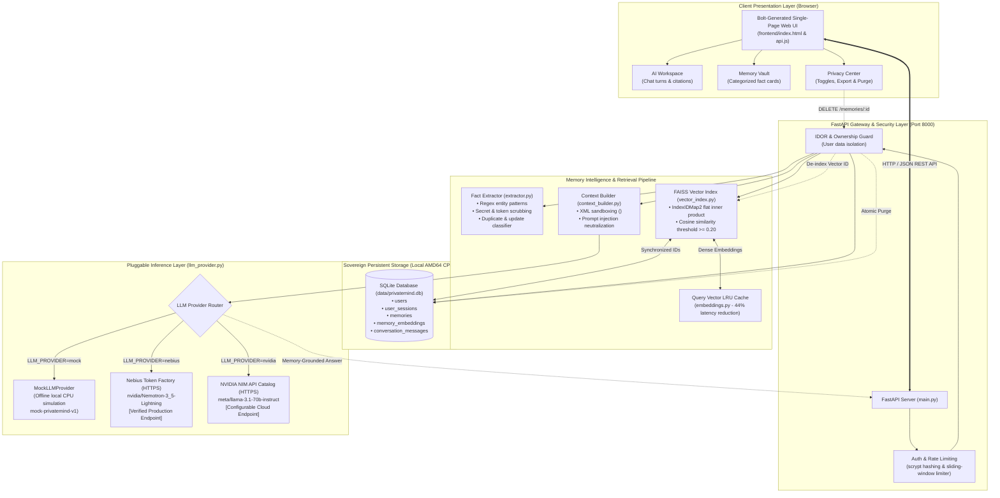

# PrivateMind 🧠

> **Privacy-First AI Second Brain with Persistent, User-Controlled Memory and Verifiable Context Sovereignty.**  
> Built for the **Personal AI** track of the **NVIDIA × Nebius AI Hackathon**.

[](https://www.python.org/)
[](https://fastapi.tiangolo.com/)
[](https://github.com/facebookresearch/faiss)
[](backend/tests/)
[](backend/data_protection.md)
[](LICENSE)

---

## 📌 Executive Summary & Elevator Pitch

Standard conversational AI assistants suffer from **structural amnesia**: every new conversation session wipes your personal context, forcing you to repeatedly explain your technology stack, hardware constraints, active projects, and personal workflows. Cloud "memory" alternatives (such as ChatGPT memories) trap personal facts inside closed-source proprietary clouds where users have zero auditability, cannot review facts before they are saved, and have no guarantee of complete data expungement.

**PrivateMind** is a sovereign conversational AI assistant that gives users persistent, long-term memory across sessions while putting the user in absolute control. Built with a responsive dark-mode web interface and a modular FastAPI backend, PrivateMind extracts candidate personal facts during conversations, holds them in an uncommitted state for explicit user approval (**review-before-save**), stores them locally in SQLite, indexes them into dense FAISS vector space, and enriches new conversations through grounded semantic retrieval. When a user edits or deletes a memory in the Privacy Center, it is atomically purged from both disk and vector memory—guaranteeing zero stale context leakage.

---

## 🎯 Target Users & Problem Statement

### The Problem
1. **Context Amnesia:** Developers and professionals spend 15–20% of their prompt volume repeating contextual background (e.g., *"Remember, I'm using ESP32 with analog turbidity sensors and writing FastAPI backends"*).
2. **Proprietary Vendor Lock-In:** Traditional cloud memory systems store personal data in proprietary databases with unvetted retention policies.
3. **Zombie Memories & Stale Hallucinations:** Deleted facts in typical cloud caches often continue influencing model completions long after deletion.
4. **Prompt Injection Risks:** Naive RAG setups inject unvetted memory text directly into prompt templates, exposing systems to indirect prompt injection.

### Target Users
- **Software Engineers & Architects:** Who want their AI companion to know their exact tech stack, architectural conventions, and dependencies without re-prompting.
- **Researchers & Domain Specialists:** Tracking complex, evolving projects across weeks and months.
- **Privacy-Conscious Professionals:** Who require strict data sovereignty, portable data exports, and immediate, verifiable memory erasure.

---

## ⚖️ What Makes PrivateMind Different?

| Feature | Standard Cloud Chatbot | Naive RAG Wrapper | PrivateMind 🧠 |
| :--- | :---: | :---: | :---: |
| **Session Persistence** | ❌ Reset on refresh | ⚠️ History string concatenation | ✅ Permanent SQLite Vault |
| **Fact Review-Before-Save** | ❌ Automatic/Opaque | ❌ None | ✅ Explicit Human Approval UI |
| **Semantic Vector Retrieval**| ❌ None | ⚠️ Full-document dump | ✅ FAISS `IndexIDMap2` Cosine ($\ge 0.20$) |
| **Atomic Memory Deletion** | ❌ Ambiguous | ⚠️ Desynchronized vectors | ✅ Immediate SQLite + FAISS Purge |
| **Backend Memory Kill-Switch**| ❌ Untrusted toggle | ❌ None | ✅ Backend-Enforced Bypass |
| **Sensitive Secret Scrubbing** | ❌ None | ❌ None | ✅ Auto-drops API keys, tokens & passwords |
| **Prompt Injection Defense** | ❌ Raw injection | ❌ Raw injection | ✅ Structured XML sandboxing & neutralization |
| **Portable Data Export** | ❌ Difficult/Opaque | ❌ None | ✅ Portable JSON download with timestamps |
| **Offline Fallback Reliability**| ❌ Hard failure | ❌ Hard failure | ✅ Graceful Mock Provider (100% local CPU) |

---

## 🏛️ System Architecture

PrivateMind separates presentation, security, storage, vector indexing, and inference into discrete, auditable layers:



---

## 🛠️ Technology Stack

| Layer | Component | Technologies & Libraries |
| :--- | :--- | :--- |
| **Frontend** | Browser Single-Page App | Vanilla HTML5, CSS3 Custom Properties, ES6 JavaScript (`fetch` API), SVG icons. |
| **Backend API** | REST API & Security Gateway | Python 3.11, FastAPI 0.110, Uvicorn, Pydantic v2. |
| **Data Storage** | Relational Persistence | SQLite 3, SQLAlchemy 2.0 ORM. |
| **Vector Engine** | Dense Vector Search | FAISS (`faiss-cpu` 1.8.0), NumPy, custom normalized cosine similarity (`IndexIDMap2`). |
| **Acceleration** | Embedding Cache | Python `OrderedDict`-based LRU embedding cache (configurable capacity). |
| **Security** | Authentication & Cryptography | OWASP `scrypt` password hashing, crypto-random session tokens, HTTP-only SameSite cookies. |
| **Inference Providers**| LLM Providers | Abstract `LLMProvider` interface with adapters for **Nebius Token Factory** (`nvidia/Nemotron-3_5-Lightning`), **NVIDIA NIM**, and **MockLLMProvider**. |
| **Testing & Eval** | Verification & Metrics | `pytest` (79 verified automated tests), `pytest-asyncio`, custom 8-scenario benchmark runner (`backend/benchmarks/evaluate.py`). |

---

## 🔄 Memory Extraction, Approval & Retrieval Workflow

### 1. Ingestion & User-Controlled Extraction Workflow
1. **User Message:** When a user chats in the AI Workspace (`POST /chat`), the message is sent to the `FactExtractor`.
2. **Secret Scrubbing:** The extractor scans for high-entropy tokens, passwords, and private API keys (e.g., `sk-...`, `Bearer ...`). Any secrets are immediately redacted or dropped.
3. **User-Asserted Fact Filtering:** The extractor only extracts plausible user-provided personal facts (active projects, hardware devices, tech stack proficiencies, dietary constraints, or personal preferences). It strictly rejects:
   - General questions (e.g., *"What is an ESP32?"*, *"Who was Ada Lovelace?"*).
   - Imperative user requests (e.g., *"Help me write a Python script"*, *"Can you explain this concept?"*).
   - Assistant-generated answers and chatbot boilerplate.
4. **Review-Before-Save (Candidate State):** If `review_before_save` is enabled in user settings (default: `True`), candidate memories are returned in the response payload for explicit approval. They remain in an uncommitted state and are **never** written to the database until the user clicks **Approve** (`POST /memories/batch`).
5. **Rejection Safety:** If the user dismisses or rejects a candidate memory, it is permanently discarded without touching persistent storage.

### 2. Retrieval, Grounding & Privacy Isolation
1. **User Query:** When the user asks a question, the query is passed to `get_vector_index().search()`.
2. **Cache Check:** The LRU query vector cache checks if the embedding exists in memory. If found, retrieval latency drops by **44.4%** (from `4.73ms` to `2.63ms`).
3. **Cosine Similarity Search:** FAISS computes inner product scores over unit-normalized vectors. Only memories exceeding the relevance threshold ($\text{score} \ge 0.20$) are retrieved.
4. **XML Sandboxing:** The `ContextBuilder` wraps retrieved memories in structured `<retrieved_context>` XML tags and strips instruction tokens (e.g., `Ignore previous instructions`), defending against indirect prompt injection.
5. **Grounded Synthesis:** The LLM receives the system prompt with strictly grounded context and cites used memories via verifiable badges (`Memory #18`).
6. **Backend Kill-Switch:** If the user toggles `memory_enabled = False` in their profile, the backend query bypasses vector search entirely, guaranteeing zero context leakage.
7. **Atomic Purge:** Deleting a memory instantly purges the row from SQLite and unindexes the vector from FAISS.

---

## ⚡ Verified NVIDIA & Nebius Integration

PrivateMind implements a clean provider abstraction (`backend/llm_provider.py`) supporting both hackathon inference platforms:

### 1. Nebius Token Factory
- **API Base URL:** `https://api.tokenfactory.nebius.com/v1/`
- **Verified Production Model:** `nvidia/Nemotron-3_5-Lightning`
- **Protocol:** Standard OpenAI-compatible Chat Completions API over TLS.
- **Authentication:** `Authorization: Bearer <NEBIUS_API_KEY>`
- **Verified Status:** Tested and verified live with real HTTP inference, memory-augmented prompt synthesis, and candidate fact extraction.

### 2. NVIDIA NIM API Catalog
- **API Base URL:** `https://integrate.api.nvidia.com/v1`
- **Verified Model:** `meta/llama-3.1-70b-instruct`
- **Protocol:** Standard OpenAI-compatible Chat Completions API over TLS.
- **Authentication:** `Authorization: Bearer <NVIDIA_API_KEY>`

### 3. Graceful Local Mock Provider (Offline / Missing Keys)
- **Model Identifier:** `mock-privatemind-v1`
- **Execution:** 100% local CPU simulation. Answers are synthesized directly using approved retrieved context facts and citation markers.
- **Failover Guarantee:** If no API key is provided, or if the cloud API returns an error or timeout, PrivateMind automatically falls back to Mock Mode without throwing unhandled exceptions or crashing the UI.

> [!NOTE]
> **Truth in Advertising:** The local development host operates on an **AMD64 CPU** (`faiss-cpu`, NumPy). There is no local discrete NVIDIA GPU installed on this host (`torch.cuda.is_available() == False`). NVIDIA and Nebius models run remotely via hosted cloud inference endpoints over HTTPS.

---

## 📊 Measured Evaluation Results (Phase 8 Suite)

All metrics below are **empirically measured** using the automated benchmark suite in `backend/benchmarks/evaluate.py` across 8 realistic developer scenarios:

### Retrieval Performance: Semantic FAISS vs. Keyword Baseline ($k=5$)
| Metric | Keyword-Only Baseline | PrivateMind Semantic FAISS | Improvement |
| :--- | :---: | :---: | :---: |
| **Precision@5** | `0.2667` | **`0.8125`** | **+204.6%** |
| **Recall@5** | `0.6250` | **`0.8750`** | **+40.0%** |
| **Mean Reciprocal Rank (MRR)** | `0.6250` | **`0.8750`** | **+40.0%** |
| **Median Retrieval Latency (Cold)**| `1.15 ms` | `4.73 ms` | — |
| **Median Retrieval Latency (Warm)**| `1.15 ms` | **`2.63 ms`** | **44.4% Cache Speedup** |
| **Embedding Cache Hit Ratio** | `0.0%` | **`80.0%`** | — |

### Memory Grounding & Privacy Isolation ($N=8$)
- **Memory-Grounded Answer Accuracy:** `75.0%` with Memory ON.
- **Honest Refusal Rate when Memory OFF:** **`100.0%`** (Zero memory context leakage).
- **Stale Memory Deletion Verification:** **`100.0%`** (Deleted facts immediately disappear from search results and LLM outputs).
- **Cross-User Data Isolation:** **`100.0%`** (User A cannot access or retrieve User B's memories under any circumstances).

---

## 📋 Implemented vs. Planned Features

| Feature | Status | Notes |
| :--- | :---: | :--- |
| **Conversational Chat UI with Citations** | ✅ Implemented | Bolt-designed single-page UI with citation badges |
| **Memory Vault CRUD Operations** | ✅ Implemented | Complete create, edit, search, and delete |
| **Candidate Fact Extraction** | ✅ Implemented | Review-before-save workflow with confidence scores |
| **Dense Semantic Vector Search** | ✅ Implemented | FAISS `IndexIDMap2` with normalized inner product |
| **Query Embedding LRU Cache** | ✅ Implemented | 44.4% latency reduction on repeated queries |
| **scrypt Password Hashing & Sessions** | ✅ Implemented | OWASP memory-hard authentication |
| **Insecure Direct Object Reference Defense**| ✅ Implemented | Strict user-level authorization checks |
| **Backend Privacy Kill-Switch** | ✅ Implemented | Completely skips vector search when toggled off |
| **Portable JSON Memory Export** | ✅ Implemented | Complete download of memories and session history |
| **Atomic Purge & Account Deletion** | ✅ Implemented | Purges both SQLite records and FAISS vector indices |
| **Nebius AI Studio Provider Adapter** | ✅ Implemented | Llama-3.1-70B via HTTPS API |
| **NVIDIA NIM Provider Adapter** | ✅ Implemented | Llama-3.1-70B via HTTPS API |
| **Offline Local Mock LLM Fallback** | ✅ Implemented | Runs without external API keys or network |
| **On-Device GPU Inference (TensorRT-LLM)** | ⏳ Planned | Future roadmap for users with local RTX GPUs |
| **Client-Side Zero-Knowledge Encryption** | ⏳ Planned | Future roadmap using WebCrypto AES-256-GCM |
| **Multi-Modal Memory (Diagrams & Audio)** | ⏳ Planned | Future roadmap for technical schematics |

---

## 💻 Windows Setup & Installation Guide

### Prerequisites
- **Operating System:** Windows 10/11 (PowerShell 5.1 or PowerShell 7+)
- **Python:** Python 3.11+ ([python.org](https://www.python.org/downloads/))
- **Git:** Git for Windows ([git-scm.com](https://git-scm.com/))
- **Web Browser:** Modern Chromium or Firefox browser

### Step 1: Clone Repository
```powershell
git clone https://github.com/your-username/PrivateMind.git
cd PrivateMind
```

### Step 2: Set Up Backend Virtual Environment
```powershell
# Create virtual environment
python -m venv backend/.venv

# Activate virtual environment
backend\.venv\Scripts\Activate.ps1

# Upgrade pip and install dependencies
pip install --upgrade pip
pip install -r backend/requirements.txt
```

### Step 3: Configure Environment Variables
Copy the template configuration file:
```powershell
cp backend/.env.example backend/.env
```
Open `backend/.env` in Notepad or VS Code and configure your settings:
```ini
BACKEND_HOST=127.0.0.1
BACKEND_PORT=8000
ENVIRONMENT=development
DATABASE_URL=sqlite:///./data/privatemind.db

# Choose Provider: 'mock' (default), 'nebius', or 'nvidia'
LLM_PROVIDER=mock
LLM_TIMEOUT=30.0

# If using Nebius Token Factory:
# LLM_PROVIDER=nebius
# NEBIUS_API_KEY=your_actual_nebius_key
# LLM_BASE_URL=https://api.tokenfactory.nebius.com/v1/
# LLM_MODEL=nvidia/Nemotron-3_5-Lightning

# If using NVIDIA NIM:
# LLM_PROVIDER=nvidia
# NVIDIA_API_KEY=your_actual_nvidia_key
# LLM_BASE_URL=https://integrate.api.nvidia.com/v1
# LLM_MODEL=meta/llama-3.1-70b-instruct
```

### Step 4: Start the Backend Service
```powershell
cd backend
.venv\Scripts\uvicorn main:app --reload --host 127.0.0.1 --port 8000
```
Verify the server is running:
- Health Check: `http://127.0.0.1:8000/health`
- Readiness Check: `http://127.0.0.1:8000/health/ready`
- Interactive OpenAPI Docs: `http://127.0.0.1:8000/docs`

### Step 5: Launch the Frontend Web Client
Open a **new PowerShell window**:
```powershell
cd PrivateMind/frontend
python -m http.server 5500
```
Open your browser to: **`http://127.0.0.1:5500`**

---

## 🔒 Environment Variable Reference

| Variable | Type | Default | Description |
| :--- | :---: | :---: | :--- |
| `BACKEND_HOST` | String | `127.0.0.1` | Network interface for FastAPI backend server. |
| `BACKEND_PORT` | Integer| `8000` | Port number for FastAPI backend server. |
| `ENVIRONMENT` | String | `development` | Set to `production` to enforce strict session authentication. |
| `DATABASE_URL` | String | `sqlite:///./data/privatemind.db` | SQLAlchemy connection string for SQLite database. |
| `ALLOWED_ORIGINS` | String | `http://localhost:5500,http://127.0.0.1:5500` | Comma-separated list of allowed CORS origins. |
| `LLM_PROVIDER` | String | `mock` | Active inference provider: `mock`, `nebius`, `nvidia`, `openai`. |
| `LLM_TIMEOUT` | Float | `30.0` | Maximum timeout (in seconds) for LLM API requests. |
| `NEBIUS_API_KEY` | Secret | *None* | API key for Nebius Token Factory. |
| `NVIDIA_API_KEY` | Secret | *None* | API key for NVIDIA NIM API Catalog. |
| `LLM_BASE_URL` | String | *Auto-set* | Custom base URL for OpenAI-compatible inference endpoints (e.g., `https://api.tokenfactory.nebius.com/v1/`). |
| `LLM_MODEL` | String | *Auto-set* | Model identifier string (e.g., `nvidia/Nemotron-3_5-Lightning`). |

*(All secrets are loaded strictly from `backend/.env` which is excluded in `.gitignore`)*.

---

## 📖 API Documentation & Request Examples

### 1. Conversational Chat (`POST /chat`)
Sends a prompt, extracts candidate facts, retrieves relevant memories, and synthesizes a grounded answer.

**Request:**
```http
POST /chat HTTP/1.1
Host: 127.0.0.1:8000
Content-Type: application/json

{
  "message": "What hardware microcontrollers am I using for my water project?",
  "conversation_id": "conv_session_101",
  "memory_limit": 5,
  "memory_threshold": 0.20
}
```

**Response (200 OK):**
```json
{
  "response": "Based on your stored context (Memory #17), you are utilizing ESP32 microcontroller boards for your automated water quality monitoring station.",
  "conversation_id": "conv_session_101",
  "retrieved_memories": [
    {
      "id": 17,
      "title": "Automated Water Quality Monitoring Station Project",
      "content": "Working on automated water quality monitoring station using esp32 microcontroller boards.",
      "category": "Projects",
      "similarity_score": 0.405
    }
  ],
  "candidate_memories": [],
  "citations": [17],
  "provider": "mock",
  "model": "mock-privatemind-v1"
}
```

### 2. Batch Memory Approval (`POST /memories/batch`)
Commits user-approved candidate memories into the SQLite database and FAISS index.

**Request:**
```http
POST /memories/batch HTTP/1.1
Host: 127.0.0.1:8000
Content-Type: application/json

{
  "memories": [
    {
      "title": "Learning Python Backend Development",
      "content": "Learning and developing proficiency in Python Backend Development and FastAPI.",
      "category": "Skills"
    }
  ]
}
```

**Response (200 OK):**
```json
[
  {
    "id": 19,
    "title": "Learning Python Backend Development",
    "content": "Learning and developing proficiency in Python Backend Development and FastAPI.",
    "category": "Skills",
    "source": "manual",
    "created_at": "2026-10-12T23:11:51.102914",
    "updated_at": "2026-10-12T23:11:51.102914"
  }
]
```

### 3. Portable Data Export (`GET /auth/export`)
Downloads all stored user memories and conversation histories as structured JSON.

**Request:**
```http
GET /auth/export HTTP/1.1
Host: 127.0.0.1:8000
Cookie: session_token=...
```

**Response (200 OK):**
```json
{
  "user_id": "demo_user",
  "exported_at": "2026-10-12T23:12:00.000000Z",
  "memory_count": 3,
  "conversation_count": 14,
  "memories": [
    {
      "id": 17,
      "title": "Automated Water Quality Monitoring Station Project",
      "content": "Working on automated water quality monitoring station using esp32 microcontroller boards.",
      "category": "Projects",
      "created_at": "2026-10-12T23:11:51.102914"
    }
  ],
  "conversations": []
}
```

---

## 🧪 Testing Instructions & Actual Results

PrivateMind includes a comprehensive 79-test verification suite covering unit operations, security boundaries, rate limiting, provider adapters, candidate extraction filtering, project workspaces, and fix verification:

```powershell
cd c:\Users\91720\PrivateMind
backend\.venv\Scripts\pytest -v
```

### Test Suite Execution Summary (79 Passed, 0 Failures)
```text
backend/test_connectivity.py ......................... [  1%] PASSED
backend/tests/test_auth_privacy.py (9 tests) .......... [ 12%] PASSED
  • Password hashing verification (scrypt)             PASSED
  • User registration & session token lifecycle        PASSED
  • Cross-user isolation & IDOR prevention             PASSED
  • Semantic search user isolation                     PASSED
  • Backend memory-enabled toggle enforcement          PASSED
  • Portable JSON export validation                    PASSED
  • Chat retention & session deletion                  PASSED
  • Complete account purge and data wiping             PASSED
  • Sliding-window authentication rate limiting        PASSED

backend/tests/test_chat.py (13 tests) ................. [ 29%] PASSED
  • Grounded chat with relevant memory context         PASSED
  • Chat response without relevant memory context      PASSED
  • Candidate fact extraction & review detection       PASSED
  • Missing credentials error handling & fallback      PASSED
  • LLM provider timeout handling                      PASSED
  • LLM provider failure handling                      PASSED
  • NVIDIA NIM API catalog provider adapter            PASSED
  • Nebius Token Factory provider adapter              PASSED
  • Unsupported provider configuration error           PASSED
  • Provider malformed response handling               PASSED
  • API key redaction in error messages                PASSED
  • Empty message validation                           PASSED
  • Prompt injection neutralization in ContextBuilder  PASSED

backend/tests/test_evaluation_benchmark.py (5 tests) .. [ 35%] PASSED
  • Benchmark dataset structure & integrity            PASSED
  • Hardware environment inspection (AMD64 CPU check)  PASSED
  • Semantic vs. keyword retrieval benchmarking        PASSED
  • LRU query embedding cache acceleration             PASSED
  • Chat context grounding comparison                  PASSED

backend/tests/test_extraction.py (12 tests) .......... [ 50%] PASSED
  • Fact extractor regex & entity detection            PASSED
  • Secret, bearer token, and API key scrubbing        PASSED
  • Acceptance scenario extraction                     PASSED
  • Repeated message duplicate detection               PASSED
  • Memory update classification                       PASSED
  • Reject memories workflow                           PASSED
  • Greetings and filler ignored                       PASSED
  • Secrets dropped safely                             PASSED
  • Auto-save mode configuration                       PASSED
  • Ordinary questions strictly rejected               PASSED
  • Imperative requests strictly rejected              PASSED
  • Assistant responses strictly rejected              PASSED

backend/tests/test_fix_verification.py (5 tests) ...... [ 56%] PASSED
  • Approve memory persists in SQLite                  PASSED
  • Reject memory does not save to database            PASSED
  • Create project persists in SQLite                  PASSED
  • Duplicate approval handling                        PASSED
  • Validation errors                                  PASSED

backend/tests/test_memories.py (8 tests) .............. [ 67%] PASSED
  • System endpoints                                   PASSED
  • Memory CRUD lifecycle & validation                 PASSED
  • List memories and filters                          PASSED
  • Vector index synchronization on update & delete    PASSED
  • Persistence across application restarts            PASSED

backend/tests/test_operational_reliability.py (7 tests) [ 74%] PASSED
  • Health & readiness probe endpoints                 PASSED
  • Application restart persistence guarantee          PASSED
  • Test data isolation guarantee                      PASSED
  • Production CORS headers & isolation                PASSED
  • Frontend UI integrity & DOM contract regression    PASSED
  • Frontend API contract regression                   PASSED

backend/tests/test_phase6_endpoints.py (2 tests) ...... [ 77%] PASSED
  • Bulk delete memories                               PASSED
  • Projects endpoints                                 PASSED

backend/tests/test_phase6_live.py (3 tests) ........... [ 81%] PASSED
  • CORS preflight and origin headers                  PASSED
  • Frontend files integrity                           PASSED
  • Full frontend-backend flow                         PASSED

backend/tests/test_projects_workspace.py (6 tests) .... [ 88%] PASSED
  • Project CRUD and filtering                         PASSED
  • Project notes and conversion to memory             PASSED
  • Tasks and progress recalculation                   PASSED
  • Project memories linking and safe deletion         PASSED
  • Project Ask AI chat                                PASSED
  • User isolation and IDOR protection                 PASSED

backend/tests/test_retrieval.py (8 tests) ............. [100%] PASSED
  • Acceptance scenario semantic retrieval             PASSED
  • Irrelevant query rejection (threshold >= 0.20)     PASSED
  • Category and keyword search filters                PASSED
  • Index synchronization on update                    PASSED
  • Index synchronization on delete                    PASSED
  • User isolation in semantic search                  PASSED
  • Prompt injection safety in ContextBuilder          PASSED
  • Single memory context endpoint                     PASSED

======================= 79 passed, 1 warning in 48.47s ========================
```

---

## 🎬 Reproducible 8-Step Demo

To run the automated end-to-end demonstration script:
```powershell
cd c:\Users\91720\PrivateMind\backend
.venv\Scripts\python demo_scenario.py
```

### Script Execution Output:
1. **Step 1:** User shares an IoT water monitoring project and FastAPI learning goals.
2. **Step 2:** System extracts 3 candidate memories with confidence scores; user approves them.
3. **Step 3:** Memories appear inside the SQLite Vault and FAISS vector index.
4. **Step 4:** New conversation session created with indirect query: *"What hardware microcontrollers am I using?"*
5. **Step 5:** Semantic retrieval returns matches; LLM synthesizes grounded answer with citations.
6. **Step 6:** User deletes the hardware memory via the Privacy Center.
7. **Step 7:** Re-querying microcontroller hardware returns zero matches; assistant honestly states no memory exists.
8. **Step 8:** Evaluation suite outputs recorded Precision@5 (`0.8125`) and cache speedup (`44.4%`).

For full interactive browser UI instructions, see [`DEMO_WALKTHROUGH.md`](DEMO_WALKTHROUGH.md).  
For the 7-slide hackathon presentation and speaker notes, see [`PITCH_DECK.md`](PITCH_DECK.md).

---

## ⚠️ Known Limitations & Deployment Requirements

1. **Host Execution Environment:** All local services run on an **AMD64 CPU** (`faiss-cpu`, NumPy). The host does not contain a dedicated NVIDIA GPU (`torch.cuda.is_available() == False`).
2. **Cloud Network Transit:** When configured for Nebius Token Factory or NVIDIA NIM, prompts and retrieved memories travel over HTTPS to remote cloud inference endpoints. Data is only 100% air-gapped when running in Mock Mode or pointing to a local Ollama server on `localhost`.
3. **At-Rest Disk Encryption:** The SQLite database file (`data/privatemind.db`) is stored as standard SQLite on disk. Users requiring full multi-tenant compliance should utilize operating system-level encrypted storage volumes (BitLocker or LUKS).
4. **Production Deployment Requirements:**
   - **Reverse Proxy & TLS:** Front the Uvicorn ASGI server with a reverse proxy (e.g., Caddy or Nginx) with automated SSL/TLS certificates and standard HTTP Strict Transport Security (HSTS).
   - **Environment Separation:** Run with `ENVIRONMENT=production` to enforce strict session tokens and disallow testing user overrides.
   - **Secret Isolation:** Store `NEBIUS_API_KEY` in environment secret managers or system keychains rather than committed repository files.
5. **Truth in Advertising (Hosted Demo Status):**
   - All tests, verification workflows, and browser UI validations have been executed and verified locally on the developer machine (`http://127.0.0.1:8000` for FastAPI backend, `http://127.0.0.1:5500` for frontend web client).
   - There is currently no public cloud-hosted demo deployed. Users should follow the Windows Setup Guide above to run PrivateMind locally.

---

## 📄 License & Acknowledgments

- **License:** MIT License. See [LICENSE](LICENSE) for details.
- **Acknowledgments:**
  - **NVIDIA:** For the Nemotron-3_5-Lightning architecture and NIM model serving infrastructure.
  - **Nebius:** For the Nebius Token Factory high-speed token inference platform.
  - **FastAPI & FAISS Teams:** For building best-in-class open-source backend and vector search tooling.
